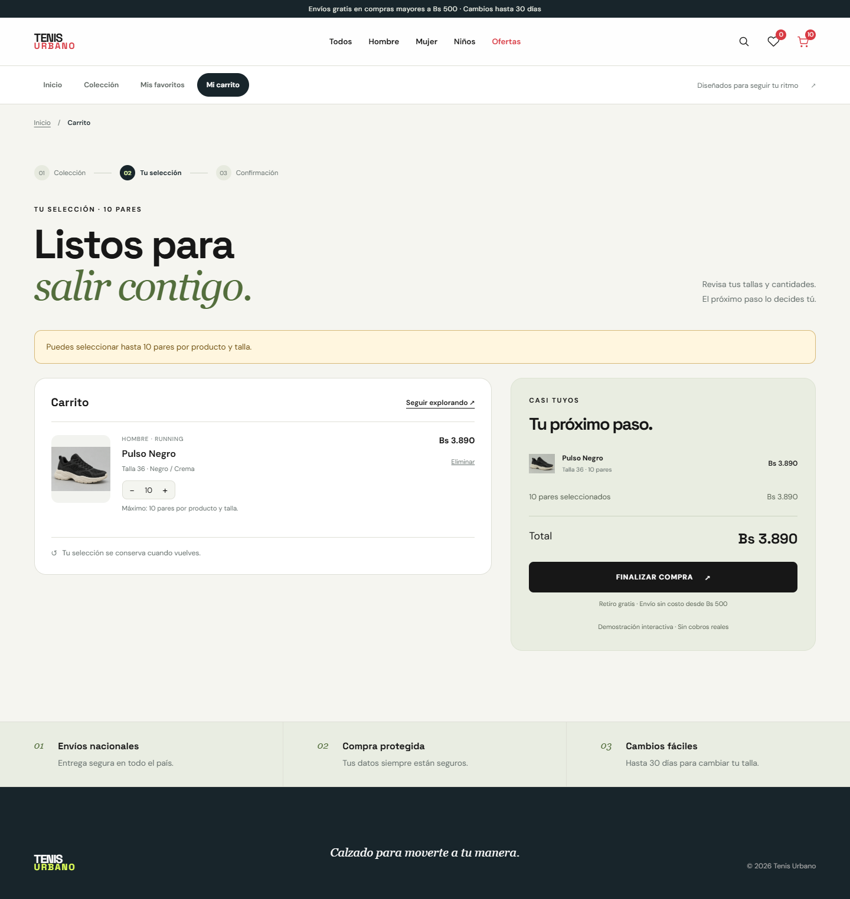

# H4 · Debate 3 · Decisión técnica aplicada

## Mejora aplicada en el vertical slice

Se reforzó la **validación del carrito**, desde su recuperación en el navegador hasta
el agregado desde el modal de producto y la modificación de cantidades. Se utiliza
un límite de **10 pares por combinación de producto y talla**. Es una regla de esta
demostración, no una comprobación de stock real.

## Riesgo inicial

`localStorage` puede alterarse desde el navegador y no es una fuente confiable. La
versión anterior comprobaba que el producto y la talla existieran y que la cantidad
fuera un entero positivo, pero:

- No establecía un máximo de cantidad ni exigía enteros seguros de JavaScript.
- Admitía registros repetidos de la misma combinación de producto y talla.
- Conservaba propiedades ajenas a la línea del carrito.
- Permitía seguir agregando unidades sin límite y mostraba éxito sin una decisión
  compartida de validación.

Esto podía producir cantidades y totales irreales o líneas duplicadas. El precio ya
se obtenía del catálogo antes del cambio; no se afirma que un campo `price` alterado
en el almacenamiento se utilizara para cobrar. Ahora también se elimina ese campo
ajeno al normalizar las líneas.

## Implementación elegida

| Parte              | Decisión aplicada                                                                                                                                                                                    |
| ------------------ | ---------------------------------------------------------------------------------------------------------------------------------------------------------------------------------------------------- |
| `src/data/cart.js` | Centraliza tallas, máximo, mensajes, normalización y operaciones del carrito.                                                                                                                        |
| Recuperación       | Acepta una lista de líneas con producto y talla existentes y cantidad entera segura positiva; descarta registros inválidos.                                                                          |
| Normalización      | Conserva solo `{ id, size, qty }`, unifica duplicados y limita la suma a 10 por combinación.                                                                                                         |
| `ShopProvider`     | Utiliza un reducer para evaluar cada operación contra el estado más reciente, incluso cuando se solicitan varios agregados seguidos. Persiste el resultado normalizado con la misma clave existente. |
| Aumentar o agregar | Rechaza el exceso sin modificar la cantidad; devuelve un mensaje de error compartido. Reducir o eliminar sigue permitido.                                                                            |
| Modal de producto  | Muestra el resultado real de la operación: éxito si se agregó, error si se rechazó. No anuncia éxito de forma incondicional.                                                                         |
| Carrito            | Muestra el aviso de recuperación o de límite mediante `role="alert"`, y el máximo junto a la línea afectada.                                                                                         |

Las reglas se aplican al cargar y al modificar. Deshabilitar únicamente un botón no
habría cubierto entradas alteradas, duplicados ni operaciones desde otra vista.

**Alcance de seguridad:** esta es una validación funcional de la SPA, no una política
RLS ni un control de autorización. El proyecto no tiene base de datos, autenticación
ni backend. Una implementación con pedidos reales deberá repetir la validación y
recalcular importes en el servidor. No se incorporaron claves, tokens ni datos
personales.

## Casos de prueba ejecutados

Se añadieron primero dos pruebas de navegador y se observaron sus fallos antes de
implementar el cambio: la recuperación dejó tres líneas en lugar de una y el modal
no presentó el rechazo esperado al alcanzar el máximo.

| Caso                    | Datos y acción                                                                                                                                                                                        | Resultado observado después del cambio                                                                                     |
| ----------------------- | ----------------------------------------------------------------------------------------------------------------------------------------------------------------------------------------------------- | -------------------------------------------------------------------------------------------------------------------------- |
| Almacenamiento alterado | Pulso Negro talla 36 repetido con cantidades 9 y 2, más registros con cantidad negativa, decimal, entero inseguro, talla inválida o producto inexistente. Se incluyó también un precio ajeno de cero. | Quedó una línea `{ id: 2, size: 36, qty: 10 }`, sin propiedades extra; total Bs 3.890 desde el catálogo y aviso de ajuste. |
| Límite y recuperación   | Intentar pasar de 10 a 11, reducir a 9, aumentar a 10 y recargar.                                                                                                                                     | El exceso se rechazó; reducir y volver a aumentar funcionó; se conservaron una sola línea y 10 unidades tras recargar.     |
| Agregados consecutivos  | Partir de 9 unidades y despachar dos agregados seguidos desde el modal en el mismo turno de eventos.                                                                                                  | La primera operación llegó a 10; la segunda se rechazó, sin mostrar un éxito falso como resultado final.                   |
| Otra talla              | Con 10 unidades de la talla 36, agregar una de la talla 37 del mismo modelo.                                                                                                                          | Se permitió: el límite pertenece a cada combinación, por lo que quedaron dos líneas válidas con 10 y 1 unidades.           |

La verificación completa incluye **11 pruebas de navegador**: las nueve existentes
y las dos nuevas de H4. La compilación y la comprobación de formato también se
verificaron.

## Evidencia visual

[Carrito con límite aplicado](15-h4-validacion-carrito.png) · [Rechazo accesible en el modal](16-h4-limite-modal.png)

## Respuesta propuesta para el debate: caso límite

> Probaría el carrito en dos pestañas del mismo navegador: ambas parten de 9 pares
> del mismo producto y talla, cada una agrega una unidad y después se recargan.
> Revisaría qué selección queda persistida y qué información recibe el usuario.
> Cada pestaña aplica el límite local, pero el estado entre pestañas todavía no se
> sincroniza; la última escritura puede reemplazar cambios de la otra. Esta prueba
> ayudaría a definir una política de sincronización o, si hay backend, una operación
> atómica de actualización. No asumiría que la validación del frontend resuelve ese
> conflicto.

La respuesta queda preparada para compartir. El caso de dos pestañas se propone
como ampliación y no se presenta como una prueba ejecutada ni una funcionalidad
resuelta. No se publicó un mensaje en un servicio externo.
